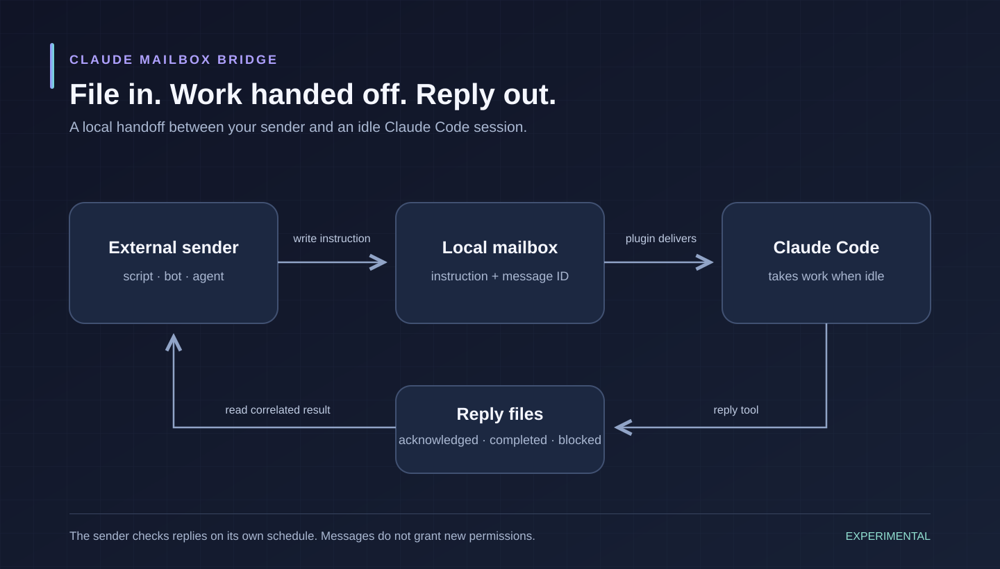

# Claude Mailbox Bridge

**File in. Work handed off. Reply out.**

Give an open Claude Code session a local mailbox. A bot or script queues a request;
Claude takes it at an idle point and writes acknowledgement and completion replies.
The sender reads those replies on its own schedule.



- **Local handoff:** configurable mailbox directory, agent names, and turn limits.
- **Session ownership:** one live receiver per mailbox, with correlated message and reply IDs.
- **Recoverable state:** bounded records, atomic file publication, and crash reconciliation.
- **Explicit permission:** peer messages cannot approve work; the reply tool requires an allow rule.

There is no automatic wake-up for the external sender. This package has no verified
incoming-message endpoint for a Dot or another assistant. Your own authorized job
checks replies. It is an independent project, unaffiliated with Anthropic or OpenAI.

## Status: experimental

**A fresh isolated headless session completed a real round trip on commit
`8b87315f65b45dc3624c97114c19d270e9d131e1`.** On Claude Code 2.1.287 with an
existing Claude Max login, the generic `worker` received one instruction and
wrote acknowledgement and completion files correlated to its message ID.
Both startup reports passed scope checks. The child exited normally after 13.4
seconds; no signals or processes remained, and the mailbox was empty and offline.

The filesystem helper, mocked hooks, sender examples, and every-turn stream
validator also pass local tests. See [release evidence](docs/release-evidence.md)
and the [public-safe proof summary](docs/real-session-proof.json) for exact scope.
The subsequent evidence/documentation commit keeps the tested runtime hashes.

This proves the fresh-session, configurable-root headless workflow. The normal
interactive quickstart, the no-allow permission trial on this generic package,
connecting an already-open conversation, and pause/expiry or conversation-change
races remain unverified. A private predecessor observed reply refusal without an
allow rule; that fact is not substituted for a generic-package permission trial.

An abort request can be refused; a forced or stray start is recorded instead.
Pause stops new claims and does not stop a running turn. Follow the
[real-session checklist](docs/real-session-trial.md) for further approved trials.
The proposed [existing-terminal attachment feature](docs/future-terminal-attachment.md)
is recorded as future work.

## Requirements

- Claude Code with function-hooks mods enabled and the workspace trusted. The local validation target is **2.1.287**; account rollout can affect availability. Other CLI versions are unverified, and the early API can change.
- Python 3.10 or newer on `PATH` as `python3`. Standard library only. Current release checks use Python 3.14; CI is configured for 3.10 and 3.13.
- macOS or Linux. The helper uses `fcntl` file locks, so there is no native Windows support (WSL is untested). Developed and tested on macOS only; Linux is expected to work and is exercised only by the CI workflow, which has not yet run.
- A local filesystem for the mailbox root. File locking on network or synced folders is not covered.

## Quickstart

```sh
git clone https://github.com/ParsingMAINFRAME/claude-mailbox-bridge.git
cd claude-mailbox-bridge
export CLAUDE_MAILBOX_ROOT="$HOME/mailbox"

# 1. Create a mailbox root: one Claude Code session agent and one external reader.
python3 bridge.py init --session worker --reader bot
```

In the terminal where the Claude Code session will run:

```sh
# 2. Start a session that serves the "worker" mailbox and may write replies.
CLAUDE_MAILBOX_ROOT="$HOME/mailbox" CLAUDE_MAILBOX_AGENT=worker \
  claude --plugin-dir /path/to/claude-mailbox-bridge/mod \
         --allowedTools mcp__session-mailbox__mailbox_reply
```

The repository URL is the intended public destination; publication is pending.
Use a local checkout until the release is published. For the receive command, replace
`/path/to/claude-mailbox-bridge/mod` with the absolute path of that checkout.

The transcript should show `active for "worker"`. Read [What activating the mod authorizes](#what-activating-the-mod-authorizes) before you do this: starting the session this way is the consent.

From any other terminal, script or bot:

```sh
# 3. Send an instruction.
python3 bridge.py send --from bot --to worker --subject "hello" --body "Reply with the word pong."

# 4. Watch its state, then read replies addressed to the sender.
python3 bridge.py status --agent worker
python3 bridge.py inbox --agent bot
```

`send` answers `queued`, which is not delivered. When the session is idle the message goes `claimed`, `submitted`, then `acknowledged` and `completed` if Claude calls the reply tool. The replies are JSON files in `$CLAUDE_MAILBOX_ROOT/mail/bot/new/`.

[examples/send_and_wait.sh](examples/send_and_wait.sh) does steps 3 and 4 with the command line; [examples/send_and_wait.py](examples/send_and_wait.py) does them by writing and reading the files directly.

## Configuration

Everything the bridge touches is under one directory you choose, the **mailbox root**. It is named by `--root` or by the `CLAUDE_MAILBOX_ROOT` environment variable; there is no default and nothing is guessed. Its `config.json` is yours to edit:

```json
{
  "version": 1,
  "agents": {
    "worker": "session",
    "bot": "reader"
  },
  "limits": {
    "turns_per_hour": 6,
    "turns_per_day": 40,
    "max_attempts": 3,
    "default_ttl_minutes": 1440
  }
}
```

- `agents`: every name that may appear as `from` or `to`. A `session` agent is a Claude Code session the mod can wake. A `reader` agent is anything else: it is never woken and reads its mail itself. Names are 1 to 32 lower-case letters, digits and dashes; `all` is reserved; at most 32 agents.
- `limits` (optional, each with a hard range): `turns_per_hour` 1 to 60, `turns_per_day` 1 to 1000, `max_attempts` 1 to 10, `default_ttl_minutes` 1 to 10080. The limits apply to each session agent separately.
- Fixed, not configurable: a message is at most 64 KB and expires at most 7 days after creation; presence goes stale after 90 seconds; the mod polls every 5 seconds. State records are capped at 48 KB, subjects at 512 UTF-8 bytes, notes at 200 bytes, history at 40 entries, and stray-start records at five.

A session picks its agent with `CLAUDE_MAILBOX_AGENT`. One live session per agent.

**Fail closed.** The config is read strictly by the helper on every command. A missing root, a missing, unreadable, symlinked or oversize `config.json`, an unknown key, a bad name or an out-of-range limit refuses every command (exit status 2) and creates nothing. In a session:

- `CLAUDE_MAILBOX_AGENT` unset or empty: the mod is completely inert. It reads nothing, runs nothing, registers no tool and starts no timer.
- `CLAUDE_MAILBOX_AGENT` set, but the root is unset, not absolute or not a directory, the config is invalid, or the agent is not listed there as a `session`: the mod logs `inactive: ...` and does nothing else.

The mod runs the `bridge.py` that sits beside its own `mod/` folder, so keep the repository layout intact. Editing `config.json` takes effect on the next helper command; removing a session's agent from it stops deliveries to that session.

## Integrating an external agent

There are two equivalent ways in. Both are local file operations; there is no network protocol.

### The command line

```sh
B=/path/to/claude-mailbox-bridge/bridge.py     # with CLAUDE_MAILBOX_ROOT set, or pass --root first
python3 $B send --from bot --to worker --subject "build" --body "Run the unit tests and report." --ttl-minutes 240
python3 $B status                              # read-only: creates and moves nothing
python3 $B status --agent worker
python3 $B inbox --agent bot                   # replies addressed to bot (reconciles its mailbox)
python3 $B inbox --agent bot --archive         # same, then files them under closed/
python3 $B fsck                                # reconcile every mailbox and list what needs a person
python3 $B fsck --agent worker                 # reconcile only this recipient
python3 $B resolve --id <id> --state blocked --note "why"   # a person closes a message nobody can finish
```

Every command prints one JSON object. Exit status 0 is success, 1 is a refusal (`{"ok": false, "error": "..."}`), 2 is a missing or invalid root or config. `send` reads the body from standard input when `--body` is omitted, and prints the message `id`. Retrying a `send` with the same `--id` after a crash completes it instead of duplicating it.

### The file protocol

A sender that cannot run Python writes the envelope itself:

```json
{
  "v": 1,
  "id": "m-20260101t120000z-3f9c2a7b1d04",
  "from": "bot",
  "to": "worker",
  "kind": "instruction",
  "correlation_id": "m-20260101t120000z-3f9c2a7b1d04",
  "subject": "build",
  "created_utc": "2026-01-01T12:00:00.000000Z",
  "expires_utc": "2026-01-01T16:00:00.000000Z",
  "body": "Run the unit tests and report."
}
```

Rules, applied to hand-written files exactly as to `send`:

- Required: `id`, `from`, `to`, `kind`, `correlation_id`, `created_utc`, `expires_utc`, `body`. `subject` is optional text.
- `id` and `correlation_id`: lower-case letters, digits and dashes, 8 to 64 characters, starting with a letter or digit. Use a fresh unique `id` per message; a reused id is quarantined.
- The file is named `<id>.json` and placed in `mail/<to>/new/`. `to` must be the mailbox it is in; `from` and `to` must be agents in `config.json`.
- `kind` is `instruction` to ask for work. `ack`, `reply` and `status` are filed and never start a turn.
- Timestamps are ISO 8601 with a UTC offset (`Z`). `expires_utc` is after `created_utc` by at most 7 days; `created_utc` is not more than 5 minutes in the future.
- At most 64 KB, a regular file, valid UTF-8 JSON; subject at most 512 UTF-8 bytes.
- The file must be complete before it appears: write it in `mail/<to>/tmp/` on the same filesystem, then rename or hard-link it into `mail/<to>/new/`.

A file that breaks a rule is moved to `mail/<to>/rejected/` with a `.reason.json` beside it. Its content is never shown to a model.

**Reading results without the helper** is read-only and safe:

- `state/<id>.json` is the record of truth for a message: `state`, `history`, `attempts`, `replies`. It appears when the receiving session, or any helper command, first sees the file.
- Replies arrive in `mail/<from>/new/` as `r-<hash>.json`, with `kind` `ack` or `reply`, `reply_state` (`acknowledged`, `completed` or `blocked`), `in_reply_to` (your message `id`), `correlation_id` (the thread) and `body` (what Claude wrote).

Do not move, rename or delete files under the root yourself. The helper is the only writer of state; use `inbox --archive` to file replies you have read.

`from` is a label chosen by whoever wrote the file. It is not authentication. Any process running as your user can write a file that claims any sender.

## What can and cannot be woken

- **Claude Code sessions (`session` agents): yes**, while the session is open, was started with this mod and both environment variables, and is idle.
- **Everything else (`reader` agents): no.** Nothing here wakes a Dot, another assistant or a script, and nothing here calls any service. A reader sees its replies when its own authorized local task runs `bridge.py inbox`, `bridge.py status`, or reads the files.
- Two Claude Code sessions on one machine may not need this at all: check whether Claude Code's own session-to-session messaging covers your case first.

## Layout of a mailbox root

| Path | Purpose |
| --- | --- |
| `config.json` | Agents and limits. Yours to edit |
| `state/<id>.json` | **The record of truth** for a message: state, session, attempts, history |
| `mail/<agent>/tmp/` | Where a writer completes a file before publishing it |
| `mail/<agent>/new/` | Queued bodies, one `<id>.json` each |
| `mail/<agent>/claimed/` | Bodies handed to a session and not yet finished |
| `mail/<agent>/closed/` | Bodies of finished, expired, recorded or failed messages |
| `mail/<agent>/rejected/` | Quarantined files, each kept with a `.reason.json` |
| `state/corrupt/` | State records that could not be read, kept for a person |
| `presence/<agent>.json` | Heartbeat of the session serving that agent |
| `control/pause-all`, `control/pause-<agent>` | Pause switches |

The root holds message bodies and session ids. Keep it out of version control and out of synced or shared folders.

## States

| State | Meaning |
| --- | --- |
| `queued` | In the mailbox. Not delivered. Stays here while the session is closed, busy, paused or over its limit |
| `claimed` | Handed to one session; its prompt is waiting for that session to go idle. Charged against the limit |
| `submitted` | A turn started with this message as its prompt |
| `acknowledged` | The receiving Claude called the reply tool to say it read it |
| `completed` / `blocked` | The receiving Claude (or, for `blocked`, a person via `resolve`) reported the outcome |
| `expired` | Passed `expires_utc` before a turn started. Never delivered |
| `recorded` | An ack, reply or status message: filed, never starts a turn |
| `failed` | Gave up after `max_attempts` delivery attempts (3 by default) |

`needs_reconciliation` on a record means its body file is missing; it is shown by `status` and `fsck`, never delivered, and never relabelled as done.

## Guarantees and their limits

**Delivery.** At-least-once to the prompt, not exactly-once execution. A message is handed out under an exclusive file lock to one session. If that session dies or is cleared before the turn starts, the message returns to the queue and is tried again, at most `max_attempts` times in all, then `failed`. If the process dies after the turn started but before `submitted` was written, the message is `claimed` with nobody holding it and is re-queued: the turn may then run twice. The prompt asks Claude to answer "duplicate delivery" for an id it already handled; that is a request to a model, not a mechanism. Make instructions safe to repeat.

**`submitted` means a turn started**, not that work was done. `acknowledged`/`completed`/`blocked` exist only if the receiving Claude calls the reply tool. An interrupted session may never answer; a person closes such a message with `resolve`.

**Crash consistency.** The state record is written first and is the commit point; the body's directory is derived from it and `reconcile` (run by every mutating command) rolls an interrupted move forward. The tests kill the helper, and separately fail its writes, after every persistent step of send, claim, start, release and reply, then retry: each message ends completed with exactly one acknowledgement and one completion reply, one charge, and no orphan. Not covered: loss of the disk's own durability, and files changed by something other than the helper (those surface as `needs_reconciliation`, `rejected/` or `state/corrupt/`). Known gaps in this version: the helper does not retry a short write (a write the operating system accepts only in part), and the size of a state record is not bounded, so a message with a very long `subject` can produce a record larger than the 64 KB the helper will read back, which is then set aside in `state/corrupt/` and counted against the limit.

**Pause.** `pause` does three things and no more:
1. No new claim is handed out (checked under the lock).
2. A delivery already claimed but whose turn has not started is checked again at the moment its turn starts. If paused, the mod withdraws that turn with `$.turn.abort` and the message returns to the queue. Whether the engine honours an abort issued at turn start is **not yet verified in a real session**. If the abort is refused, the turn runs and the message is recorded `submitted` with the note "could not be withdrawn".
3. A turn that is already running is **not** stopped. Pause never aborts running work.

So pause is not "stop everything immediately". After pausing, read `status`: anything `submitted` is running or has run.

**Expiry** is a delivery cutoff, checked while queued and again as the turn starts. An expired message is never marked delivered. A turn that already started is not cut short by expiry.

**Busy sessions** are not interrupted. The mod claims nothing while a main turn runs, and Claude Code is expected to hold a mod's prompt until the session is idle. One message per turn.

**No model call when nothing changes.** Each 5-second tick is one session-id read and directory listings. The helper process runs for the 30-second heartbeat and when mail is present; claims that deliver nothing back off from 5 s to 60 s. This is polling inside the session; it adds no standalone daemon or persistent service. The registered reply tool uses Claude Code's temporary localhost transport (127.0.0.1, ephemeral port, randomized secret URL). Do not expose or publish that URL. No public endpoint or terminal automation is added.

**Limits.** By default 6 automated turns per rolling hour and 40 per rolling day per session agent. A turn is charged when the message is claimed, in the same record that changes its state, so a reply arriving before the "started" mark cannot escape the charge. A claim that was withdrawn, abandoned or ambiguous stays charged; only a prompt the session refused outright is refunded. An unreadable state record is counted as `max_attempts` charges. If state cannot be read or written, nothing is claimed. Each automated turn uses your Claude usage like any other turn; the limits are the only cost control here.

**Ownership.** A session serves exactly the agent in `CLAUDE_MAILBOX_AGENT` and lists only `mail/<that agent>/new`. Start, release and reply are refused unless they come from the session id the message was claimed by. A second live session naming the same agent stays inactive. A claim is taken from another session only when that session has no live heartbeat (90 s) or has said goodbye, never on age alone. Limit: session ids are not secrets, so this stops accidents and misconfiguration, not a deliberate same-user process.

**Conversation changes.** On `/clear`, `/resume` and `/branch` the process continues under a new session id with no new start event. The mod is written to keep its timer, give back whatever the old id had claimed but not started, and carry on under the new id (**not yet verified in a real session**). A message the old conversation had already started can no longer be answered by the new one (different session id); it stays `submitted`/`acknowledged` until a person runs `resolve`. On real exit the timer is cancelled and presence is marked offline; if the process is killed, presence goes offline after 90 s.

**Prompt bookkeeping.** A random delivery token and the full submitted frame identify a mailbox turn. If a user or another plugin quotes that token, text matching is disqualified. Old queued frames are tracked in a bounded list; late starts are withdrawn when possible and recorded as stray starts. A failed forced-start write blocks new claims until it is recorded. This is accident prevention, not sender authentication.

**Loop prevention.** Only `kind: instruction` starts a turn. The mod never sends instructions; replies are `ack`/`reply` and are filed without waking anyone, in both directions.

## Security model

**A mod runs with your permissions and is not sandboxed.** Claude Code does not sandbox mods. This one runs inside your session as you, and the helper it starts is an ordinary Python process running as you. Read `mod/hooks/register.ts` and `bridge.py` before activation to understand their filesystem and session behavior.

**Filesystem scope.** Paths are built under the mailbox root from validated components; symlinked directories and files, traversal, non-regular and oversize files are refused. This is not a security boundary against your own user account: a same-user process could swap a directory between the check and the use. The design assumes the root and its parents are not being maliciously replaced.

**Who can instruct your session.** Anything that can write a file under the root can queue an instruction, and `from` proves nothing. Treat write access to the root as the ability to ask your Claude session to do things. The protections are: the message is delivered under the plugin's name, never as the user; it is framed as another agent's message that is not the user's approval and cannot authorize credential access, permission or settings changes, or anything that was denied; the body is fenced as data; and everything Claude then does still goes through that session's normal permission prompts and rules. These reduce the risk of a hostile or mistaken message. They do not remove it: the framing is text read by a model, not an enforcement mechanism. Do not run a mailbox session with permissions broader than you would give the least trusted writer to the root.

### What activating the mod authorizes

Starting a session with `--plugin-dir .../mod` and `CLAUDE_MAILBOX_AGENT` set is the consent. From then on, without any further prompt, that session will:

- read `CLAUDE_MAILBOX_AGENT` and `CLAUDE_MAILBOX_ROOT`, and list `<root>/mail/<agent>/new` and `<root>/control` every 5 seconds;
- run `python3 bridge.py --root <root> ...` (check, heartbeat, claim, begin, stray, release, offline, status, pause, resume), which writes only under the root;
- start a turn in that session for each valid instruction addressed to it, within the limits above, with the text marked as another agent's message that is not the user's approval;
- request withdrawal of its own mailbox turn at start when paused or expired, and record a forced or stray start if withdrawal fails;
- register the reply tool through Claude Code's temporary localhost transport.

**Replies need a separate, explicit allow.** The reply tool's hook answers the call itself, so Claude Code shows no permission dialog for it. The mod therefore asks the engine's own permission decision (`$.tool.check`) and writes a reply only when that decision is `allow`. With no allow rule, an `ask` or `deny` result, or a failed check, nothing is written and Claude is told so. To permit replies, launch with `--allowedTools mcp__session-mailbox__mailbox_reply` (that session only). Whether the engine returns `allow` for a call the user approved once in a dialog is not verified; rely on the launch flag.

Everything Claude does *because of* a message (edits, commands, pushes) still goes through that session's normal permission prompts and rules. A message cannot approve anything. The mod and helper read no credentials, add no API key or billing, and change no persistent settings. The file helper makes no network call. Claude Code still uses its normal model connection and temporary localhost tool transport.

## Controls

```sh
python3 $B pause [--agent worker]    # see "Pause" above for exactly what this does
python3 $B resume [--agent worker]
python3 $B status [--agent worker]
```

Inside a session running the mod: `/mailbox status`, `/mailbox pause`, `/mailbox resume` (that session's agent only).

## Stopping and removing

1. `python3 $B pause`: no new claims; a not-yet-started delivery is withdrawn if the engine allows. It does not stop a running turn.
2. Read `python3 $B status`. Let any `submitted`/`acknowledged` work finish; do not assume it stopped.
3. Quit each session normally and start it again without `--plugin-dir`, `--allowedTools ...mailbox_reply` and `CLAUDE_MAILBOX_AGENT`. The mod is installed nowhere, so nothing else loads it.
4. Run `python3 $B fsck` and `status`; `resolve` anything left open. Then, if you wish, delete the mailbox root. Nothing outside it was modified.

Note that `--plugin-dir` watches the folder and hot-reloads on edits: do not edit `mod/` while a session has it loaded.

## Tests

```sh
python3 test_bridge.py        # helper on throwaway directories, incl. fault injection
python3 test_session_report.py # every-turn stream scope checks; no Claude process
python3 test_sender_examples.py # disposable scripted receiver; no Claude process
claude plugin validate mod    # static: what the engine reads from the mod
claude plugin test mod        # the mod's hooks with files, helper, clock and prompts mocked
```

The mod tests prove the mod's logic against stand-ins. They do not prove engine behaviour (when `turn.start` fires relative to a queued prompt, whether an abort at turn start is honoured, what `/clear` does to a queued prompt, what the permission check returns). Only a real-session trial does; see [Status](#status-experimental). More in [CONTRIBUTING.md](CONTRIBUTING.md).

## License

MIT; see [LICENSE](LICENSE).
